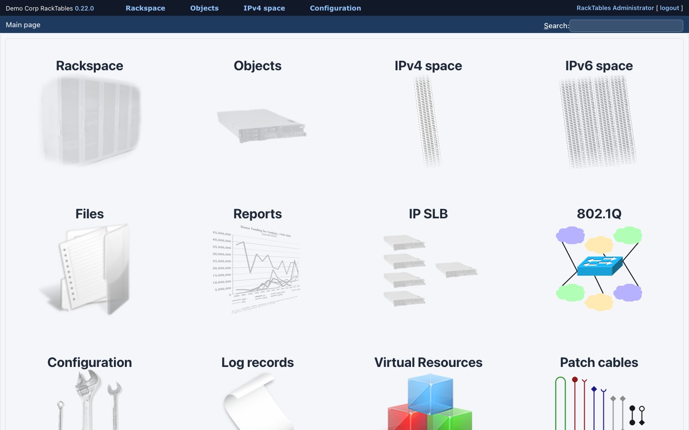
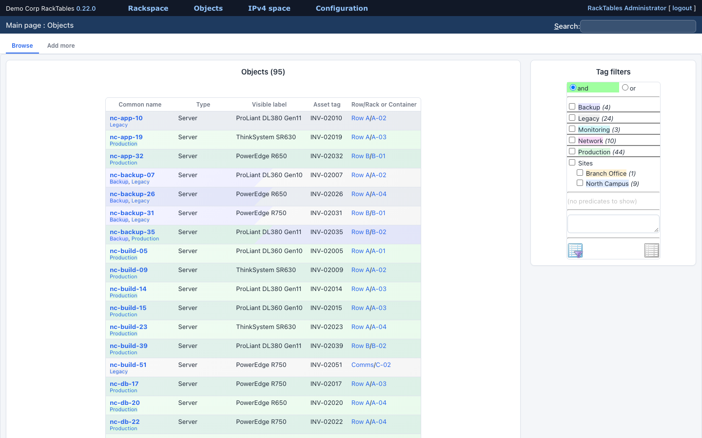
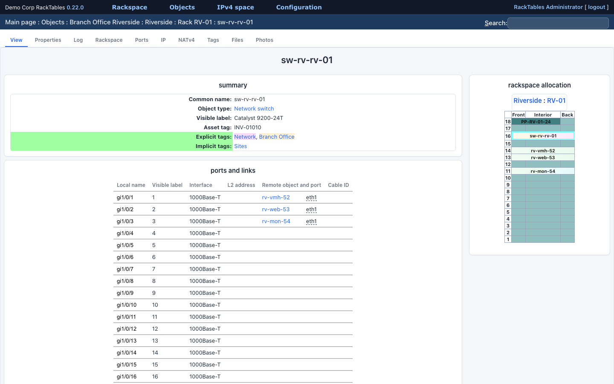
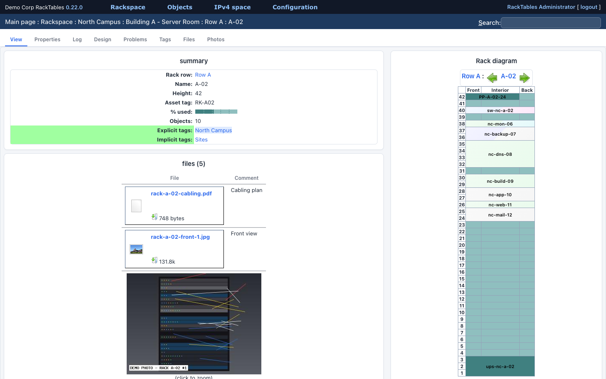
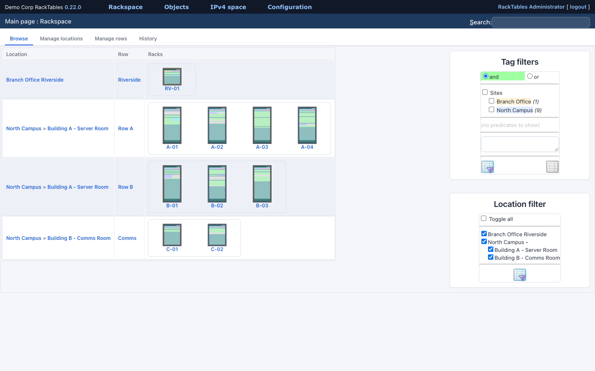
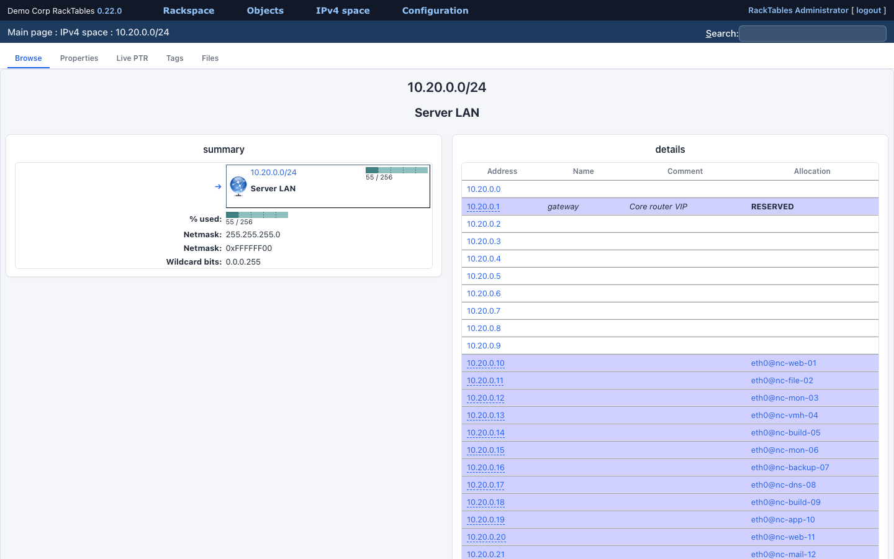
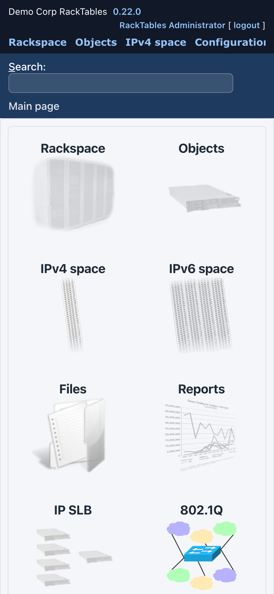
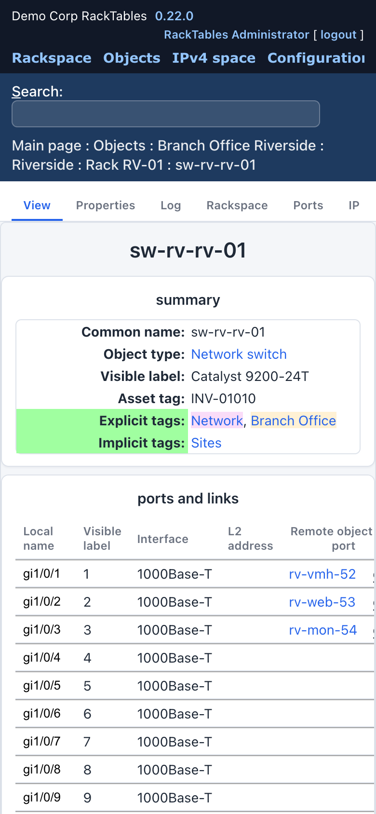

# RackTables Refresh Theme

A light, modern visual layer for [RackTables](https://www.racktables.org/), packaged as a plugin.
It restyles the stock interface without touching RackTables core files.

## Screenshots

Taken on a demo instance with generated data (no real records).

| | |
|---|---|
| **Main page**<br> | **Objects**<br> |
| **Object**<br> | **Rack**<br> |
| **Rackspace**<br> | **IPv4 network**<br> |

**Mobile**

 

## What it changes

- **Typography:** system UI font stack instead of Verdana/Arial, slightly larger base size.
- **Header and breadcrumb bar:** dark slate header, navy breadcrumb bar, rounded search field.
- **Tabs:** underlined active tab instead of boxed tabs.
- **Portlets:** white cards with a subtle border and shadow instead of dashed blue frames.
- **Tables:** muted headers, stronger zebra striping, row separators, row hover highlight, soft borders.
- **Forms:** rounded inputs, visible focus ring, accent-colored submit buttons.
- **Main page:** larger tile headings with a subtle hover effect.
- **Type-to-filter for long drop-downs:** every list with 15+ options (link existing file,
  parent container, object type, ...) gets a small filter field above it. Matching ignores
  case and diacritics; several words must all match. Enter does not submit the form,
  Esc clears the filter, Arrow Down jumps into the list.

- **Rackspace:** racks in fixed width columns, long rack names wrap instead of shifting racks.
- **Mobile:** layout below 768 px (adds the viewport meta RackTables lacks): stacked columns,
  scrollable tabs and wide tables, two column main page, 16 px form controls.
- Filter keeps chosen options of multi-select lists, so they are always submitted.

## What it leaves alone

- Rack diagram state colors (free / occupied / problem) and tag colors.
- Page layout. RackTables builds pages from tables, so this is a reskin, not a new UI.

## Compatibility

Tested with RackTables **0.22.0**. Should work with 0.21.x (same plugin architecture),
but that has not been verified.

## Installation

1. Copy the `refreshtheme` directory into the RackTables `plugins/` directory:

   ```
   plugins/
     refreshtheme/
       plugin.php
       css/theme.css
       js/select-filter.js
   ```

2. In RackTables, open **Configuration -> Plugins**, find **Refresh Theme** and click **Install**.
3. Reload the page (hard refresh, e.g. Ctrl+Shift+R, to bypass the cached stylesheet).

Upgrading from an older version: replace the directory; if Configuration -> Plugins
offers **Upgrade**, click it (it only updates the stored version number).

To remove it, click **Uninstall** in the same place (or disable it there); nothing is
stored in the database apart from the plugin record.

### Docker image

```dockerfile
COPY refreshtheme /var/www/racktables/plugins/refreshtheme
```

Then install it once via Configuration -> Plugins as above.

## How it works

`plugin_refreshtheme_init()` calls `addCSSInternal('refreshtheme/css/theme.css')`. Plugins are
initialized after RackTables adds its default `css/pi.css`, so the theme's rules take
precedence. It also calls `addJSInternal('refreshtheme/js/select-filter.js')` for the
filter fields (plain JavaScript, no dependencies). Both files are served by RackTables itself (`?module=chrome`) from the
plugins directory, so no web server changes are needed.

## Customizing colors

All colors are CSS custom properties at the top of `css/theme.css` (`--rt-accent`,
`--rt-header`, `--rt-bar`, `--rt-row-alt`, ...). Change them there.

## License

GPL-2.0, the same as RackTables. See [LICENSE](LICENSE).
